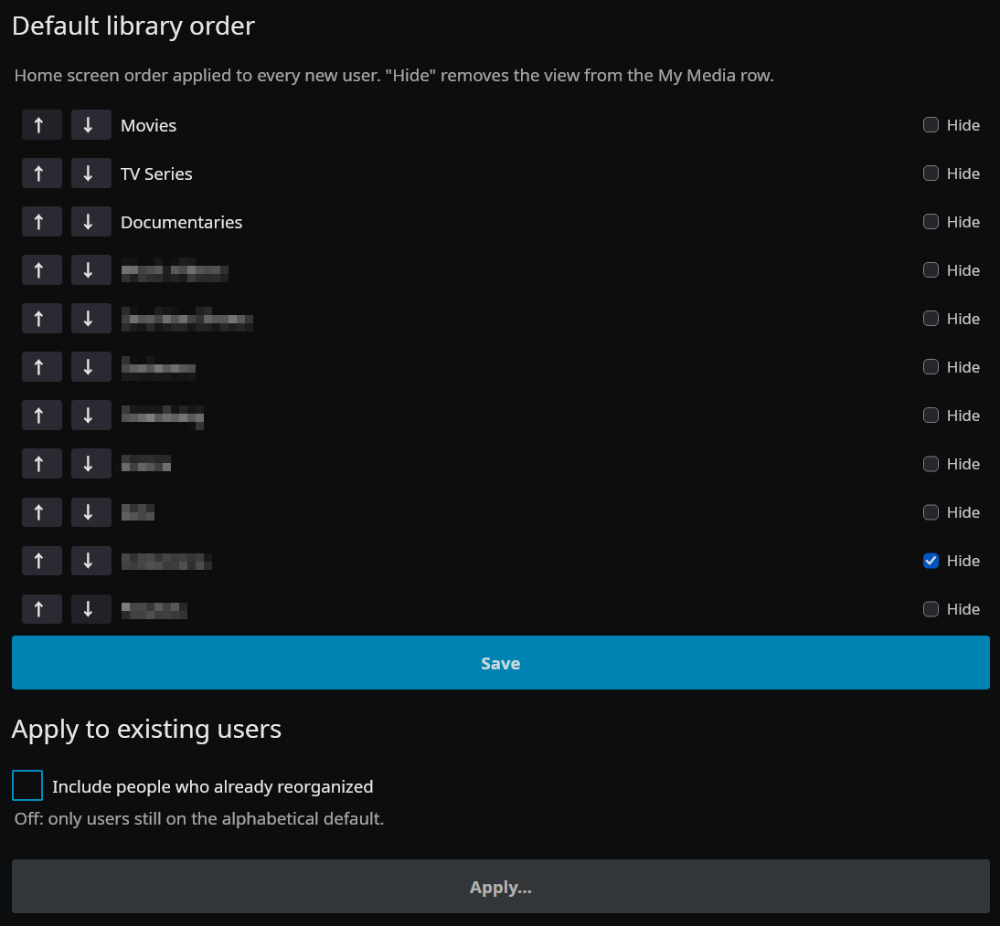

# JellyDefaults

A Jellyfin plugin that gives users a default home screen library order instead of the alphabetical one, and default library sorting (e.g. newest first).

## Features

- Define the library order (and which views are hidden from "My Media") once, in the plugin settings
- Every newly created user gets it automatically
- Apply it to existing users: only those still on the alphabetical default, or everyone (opt-in checkbox), after a confirmation listing the affected users
- Default sort of each library's main tab (Movies, Shows, Albums, mixed-content folders), imported from a user's current sorts (yourself by default; only sorts changed from Jellyfin's default, deleted libraries skipped)
- Sorts apply to new users automatically, and to existing users per library: only where they're still on the default sort, or everywhere (opt-in checkbox). The confirmation lists how many libraries change per user
- Sorts are stored in the web client's server-side preferences: they apply to web-based clients (browser, Jellyfin Media Player, Android/iOS apps), not to TV apps (Android TV, Swiftfin…), which keep their own
- Optional entry in the admin sidebar menu
- Check out my other plugins: [JellyRate](https://github.com/trecoool/jellyrate), [JellyRequest](https://github.com/trecoool/jellyrequest) and [JellyPrecache](https://github.com/trecoool/jellyprecache).

## Screenshots



## Requirements

- Jellyfin 12.3+ (tested on 12.4.0)
- .NET 10.0

## API Endpoints (admin only)

| Method | Route | Description |
|--------|-------|-------------|
| GET | `/JellyDefaults/Views` | Top-level views (libraries, Playlists, Collections) |
| POST | `/JellyDefaults/Apply?includeCustomized=&dryRun=` | Apply the library order to existing users, returns affected user names |
| GET | `/JellyDefaults/Sorts?userId=` | A user's main-tab sorts that differ from the default (import source) |
| POST | `/JellyDefaults/ApplySorts?includeCustomized=&dryRun=` | Apply the sorts to existing users, returns `{Name, Tabs}` per affected user |

## Installation

### Via plugin repository (recommended)

1. In Jellyfin, go to **Dashboard → Plugins → Repositories**.
2. Click **+** and add:
   - **Name**: `JellyDefaults`
   - **URL**: `https://raw.githubusercontent.com/trecoool/jellydefaults/master/manifest.json`
3. Open the **Catalog** tab, find **JellyDefaults**, and install it.
4. Restart Jellyfin.

### Manual install

1. Download the latest `jellydefaults_<version>.zip` from the [Releases](https://github.com/trecoool/jellydefaults/releases) page.
2. Extract `JellyDefaults.dll` to `<jellyfin-config>/plugins/JellyDefaults/`.
3. Restart Jellyfin.

### Build from source

```bash
dotnet build -c Release
```

Copy `bin/Release/net10.0/JellyDefaults.dll` to `<jellyfin-config>/plugins/JellyDefaults/`, then restart Jellyfin.
